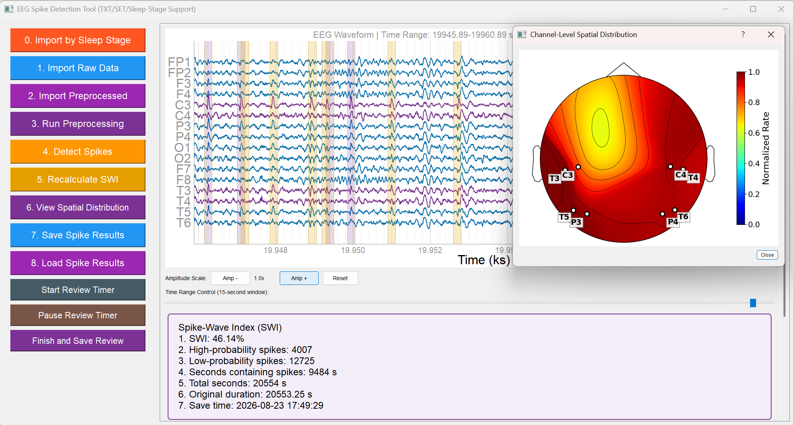

# An End-to-End Framework for Long-Term Epileptic Spike Detection in Pediatric Electroencephalography

[](https://www.embs.org/)
[](https://www.python.org/)
[](https://pytorch.org/)

Official code for the paper **“An End-to-End Framework for Long-Term Epileptic Spike Detection in Pediatric Electroencephalography,”** published at the **2026 IEEE EMBS International Conference on Biomedical and Health Informatics (BHI 2026)**.

**Authors:** Yifei Bai, Chenghao Xue, Lin Xu, and Yuanning Li

**Affiliations:** ShanghaiTech University, Shanghai, China

This repository provides the proposed LR34-SK detector, its clinical review interface, the final AUG06 training configuration, patient-level spike-wave index (SWI) evaluation code, and training implementations of five representative EEG baselines.

> This software is intended for research and assistive EEG review. It is not a standalone diagnostic system.

## Overview

The framework detects epileptiform spikes in long-term non-rapid eye movement (NREM) EEG from patients diagnosed with self-limited epilepsy with centrotemporal spikes (SeLECTS). It integrates:

- 16-channel EEG preprocessing and 0.2-second sliding-window analysis;
- raw EEG, first- and second-order differential features, and smoothed nonlinear energy (SNE);
- a Lightweight ResNet-34 backbone with spatial pyramid pooling (SPP);
- a Kolmogorov–Arnold Network (KAN) classifier;
- automatic candidate detection and confidence visualization;
- sleep-stage import, expert confirmation/correction, autosave, and result management; and
- patient-level SWI estimation using original annotation timestamps and one-second epochs.



## Results reported in the paper

Patient-grouped five-fold cross-validation was performed on 44 pediatric patients. Values below are mean ± standard deviation from the final paper.

| Metric | LR34-SK |
| --- | ---: |
| Accuracy | 96.04% ± 0.63% |
| Macro-F1 | 92.90% ± 0.71% |
| Spike F1 | 88.18% ± 1.17% |
| PR-AUC | 95.17% ± 0.82% |
| Patient-level SWI absolute error | 5.48% ± 4.91% |

The long-term workflow was additionally evaluated on three recordings containing approximately 5.7–7.4 hours of analyzable NREM EEG per recording.

## Final training protocol

The proposed model and all five baseline training scripts use the same final experimental configuration where applicable:

- patient-grouped five-fold `GroupKFold` with random seed 42;
- 16 channels sampled at 500 Hz;
- model input windows of 0.2 seconds;
- batch size 64, 50 epochs, learning rate `1e-4`, and weight decay `1e-4`;
- focal loss with alpha 0.65 and gamma 2.0;
- early stopping with patience 5 and minimum delta 0.003; and
- final AUG06 positive-sample augmentation.

For AUG06, each positive window in the training fold receives one additional copy. The copy first receives zero-mean Gaussian noise with a standard deviation equal to 3% of the original window standard deviation and is then reversed along the true time axis. Validation and held-out prediction windows are not augmented.

## Repository structure

```text
SELECTS-SpikeNet/
├── interface/
│   ├── interface.png
│   └── code/
│       ├── main.py                         # Proposed-model interface entry point
│       ├── config.py                       # Repository-relative configuration
│       ├── fold_3_best_weights.pth         # Proposed LR34-SK inference checkpoint
│       ├── weight_provenance.json          # Checkpoint protocol and SHA-256
│       ├── requirements.txt
│       ├── core/                           # Model, features, preprocessing, metrics
│       ├── ui/                             # Dialogs and interface components
│       ├── utils/                          # EEG and result-file I/O
│       └── visualization/                  # Spatial-distribution visualization
├── Train model/
│   ├── config/config.yaml                  # Final LR34-SK/AUG06 configuration
│   ├── Requirements.txt
│   └── src/
│       ├── train.py                        # Proposed-model cross-validation
│       ├── recompute_patient_swi_tables.py # Final patient-level SWI/SWIAE
│       ├── models/                         # LR34, SPP, KAN, and fusion model
│       └── utils/                          # AUG06, preprocessing, and metrics
├── final_baselines/
│   ├── EEGNet/train.py
│   ├── EEGNeX/train.py
│   ├── EEGFormer/train.py
│   ├── EEGPT/train.py
│   └── LaBraM/train.py
└── legacy_baseline_reproductions/          # Archived exploratory code, not final results
```

## Proposed-model interface

Only the proposed LR34-SK interface and inference checkpoint are distributed. Baseline interfaces and trained baseline checkpoints are not included.

### Installation

Python 3.9 or later is recommended. On Windows:

```bash
git clone https://github.com/bai-yf/SELECTS-SpikeNet.git
cd SELECTS-SpikeNet/interface/code
python -m venv .venv
.venv\Scripts\activate
pip install -r requirements.txt
```

The interface uses MATLAB Engine and EEGLAB for the MATLAB preprocessing path. Install MATLAB Engine for Python and configure the local EEGLAB path before using that path. EDF and preprocessed EEGLAB SET input are also supported by the interface.

### Run

```bash
cd SELECTS-SpikeNet/interface/code
python main.py
```

Windows users may alternatively run `run_V9_interface.bat` after configuring its local environment.

### Proposed checkpoint

The checked-in inference checkpoint is:

```text
interface/code/fold_3_best_weights.pth
```

- Model: LightResNet34 + SPP + KAN (LR34-SK)
- Designated training protocol: AUG06
- SHA-256: `C097AD93595246434172342223AC2469496DDD2B18E3C5DB757305156AD04595`

The interface loads this checkpoint locally; it does not download or substitute a different model.

## Training the proposed model

Prepare the preprocessed window cache and its metadata CSV, then update the paths in `Train model/config/config.yaml`.

```bash
cd "Train model"
pip install -r Requirements.txt
python src/train.py
```

The cache metadata must include `patient_id` so that cross-validation remains patient-grouped. See [`Train model/README.md`](Train%20model/README.md) for the expected paths and outputs.

## Final baseline implementations

Standalone training scripts are provided for EEGNet, EEGNeX, EEGFormer, EEGPT, and LaBraM.

They retain their model-specific architectures and input adapters while sharing the final patient split, AUG06 augmentation, optimizer, training budget, focal loss, and evaluation settings with the proposed model where applicable. EEGPT and LaBraM require their official upstream repositories and pretrained checkpoints.

See [`final_baselines/README.md`](final_baselines/README.md) for setup and checkpoint links. The scripts generate their own fold checkpoints and held-out prediction tables; trained SOTA weights are not distributed in this repository.

## Patient-level SWI and SWIAE

The final paper does not calculate SWI by grouping every five array rows. For each patient:

1. The prediction coverage is divided into non-overlapping one-second epochs.
2. A true epoch is positive when at least one original expert spike timestamp falls within that second.
3. Each 0.2-second prediction window is assigned by `mid_time_sec`; predictions within a second are combined using logical OR.
4. Patient error is `abs(SWI_true - SWI_pred)`.
5. SWIAE is the macro-average of patient-level absolute errors.

Recompute the final tables with:

```bash
cd "Train model"
python src/recompute_patient_swi_tables.py \
  --predictions-dir results/predictions \
  --annotations-csv data/annotation_times.csv \
  --output-dir results \
  --window-sec 0.2
```

The annotation CSV must use long format with columns `patient_id` and `spike_time_sec`. The method identifier written to the output is `annotation_1s_epoch_midtime_prediction`.

## Data availability

Patient EEG recordings and identifiable clinical annotations are not distributed in this repository. Users must prepare their own data in the documented 16-channel format and provide patient-group metadata and spike timestamps. Runtime outputs, caches, and temporary preprocessing files are excluded from version control.

## Citation

If you use this repository, please cite:

```bibtex
@inproceedings{bai2026endtoend,
  title     = {An End-to-End Framework for Long-Term Epileptic Spike Detection in Pediatric Electroencephalography},
  author    = {Bai, Yifei and Xue, Chenghao and Xu, Lin and Li, Yuanning},
  booktitle = {2026 IEEE EMBS International Conference on Biomedical and Health Informatics (BHI)},
  year      = {2026},
  publisher = {IEEE}
}
```

DOI and proceedings pagination can be added when the final IEEE record is available.

## Acknowledgments

The proposed classifier uses the [`efficient-kan`](https://github.com/Blealtan/efficient-kan) implementation of Kolmogorov–Arnold Networks. EEGPT and LaBraM baseline experiments use their respective official pretrained models; links and placement instructions are provided in the baseline README.
